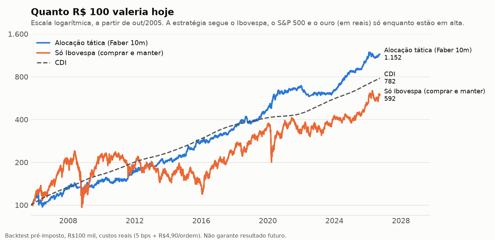
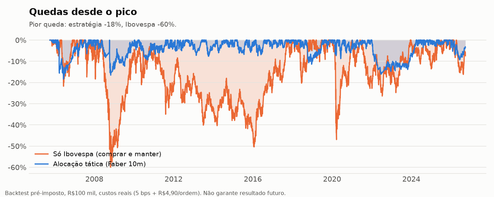
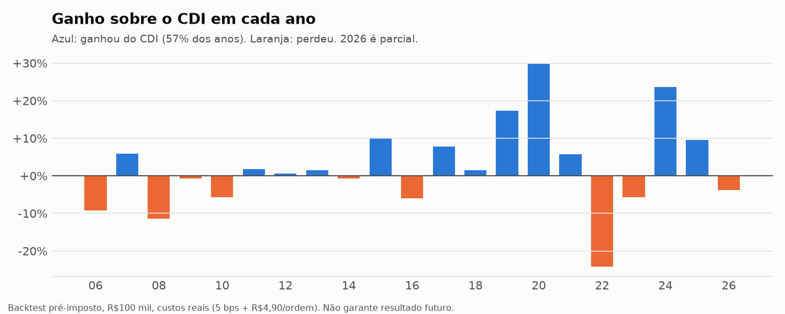

# trader — trade sistemático B3 (MT5 + Python)

> [!WARNING]
> **Projeto didático, feito com ajuda de IA. Não é recomendação de investimento.**
>
> O código, os backtests e o `RESEARCH_LOG.md` foram desenvolvidos com auxílio de
> um assistente de IA, como exercício de estudo de trade sistemático. Podem conter
> erros de lógica, de dados, de custos ou de impostos que não foram percebidos.
>
> - Resultado de backtest não garante resultado futuro, mesmo com validação fora da
>   amostra. Viés de sobrevivência, dados do Yahoo e custos estimados podem inflar
>   os números (ver §23 do `RESEARCH_LOG.md`).
> - **Tome muito cuidado antes de colocar dinheiro real.** Rode em conta demo,
>   entenda cada linha do que vai enviar ordens e comece com um valor que você
>   aceita perder por inteiro.
> - Custos, emolumentos e regras de IR mudam: confira com a sua corretora, a B3 e
>   um contador.
>
> O software é fornecido "como está", sem garantia de nenhum tipo (licença MIT, ver
> [`LICENSE`](LICENSE)). O uso é por sua conta e risco; o autor não se
> responsabiliza por perdas.

Programa de trend swing em ações da B3. Ver **`RESEARCH_LOG.md`** para o histórico
completo da pesquisa (o que foi testado e os vereditos).

## Setup

```bash
conda env create -f environment.yml        # cria o env "trade" com as versões testadas
conda activate trade
```

Sem conda: `pip install -e ".[mt5,ml,dev]"` (o `mt5` só instala no Windows).

## CAMPEÃO

Cesta de 5 (PETR4, VALE3, ITUB4, BBDC4, ABEV3) + **SuperTrend(10, 3×) long-only +
vol-target Yang-Zhang (alvo 0,15) + equal-weight, sem trailing**.

Walk-forward OOS 2015–2026, CDI creditado no caixa: **CDI + ~4% a.a., max drawdown
~−5%, Sharpe sobre o CDI ~0,6, ~25–33% investido** (resto em caixa rendendo CDI).
Pré-imposto. Rodando no paper-trade da conta demo.

> **Atenção (§23 do RESEARCH_LOG):** esse número usa a cesta escolhida com a lista de
> hoje e dados do Yahoo. Com a cesta escolhida só com o que se sabia (5 mais negociadas
> no início de cada ano) e dados da B3: **CDI +0,6% pós-IR em 2014–26, CDI −1,1% em
> 2010–26**. O modelo de fatores sem viés de sobrevivência fica no CDI.

## Alocação tática (§25) — supera o campeão

Ibovespa (BOVA11), S&P 500 em reais (IVVB11) e ouro (GOLD11), 1/3 cada, só se o mês
fechou acima da média de 10 meses; senão a fatia fica no CDI. Rebalanceamento mensal,
~7 ordens por ano. Com custos reais: **CDI +3,2% a.a. em 2010–26 (campeão causal:
−0,2%) e +4,6% em 2014–26 (campeão: +1,8%)**, queda máxima −16 a −18%. O ganho vem da
diversificação internacional em reais (Ibov x S&P com correlação −0,05); não ganha do
CDI todo ano (57% dos anos em 2005–26; 2005–15 ficou no CDI). Meio a meio com o
campeão: queda máxima −7 a −8% e 71–77% dos anos acima do CDI.







Os gráficos são gerados por `python scripts/make_readme_charts.py` (2005–2026, R$100 mil,
pré-imposto). Ressalva honesta: boa parte do ganho vem de 2019–2020 e 2024; em 2022 a
estratégia ficou 24 pontos abaixo do CDI.

## Scripts (rodar da raiz do repo)

**Dados** — `pull_daily` `pull_basket` `pull_universe` `pull_factor_universe`
`pull_futures_proxy` `pull_cdi` `pull_mt5_history` `pull_intraday` `pull_mt5_intraday`
(WIN/WDO/PETR4 em M5 e M1, 5 anos, do MT5 da XP) `pull_share_classes` (ON/PN/units)
`pull_etfs` (BOVA11 — abertura real; a do ^BVSP no Yahoo é falsa) `pull_cotahist` +
`build_options_db` (séries históricas da B3 2008–2026: todos os negócios, opções com
bid/ask, inclusive ações deslistadas) `build_stocks_db` (todas as ações do lote padrão
para o painel sem viés) `pull_taa` (BOVA11, IVVB11, GOLD11, SMAL11 + referências longas
em reais para a alocação tática)

**Pesquisa** — `research_strategies` (trend family + vol-target) ·
`research_cross_sectional` (momentum cross-sectional — falhou) · `research_futures`
(WIN/WDO — não ajudou) · `factor_model` (fatores B3 no universo grande) ·
`ml_baseline` / `ml_experiment` (LightGBM — AUC 0,54, não bate a regra) ·
`research_grid_averaging` (averaging down "nunca realiza perda" — bate o CDI mas
perde pro buy&hold e tem cauda feia) · `research_markov_regime` (regime de Markov
do vídeo + HMM — persistência é artefato da janela; dominado pelo campeão) ·
`research_intraday` (scalping/day trade em WIN, WDO e PETR4 com custos reais da XP
— nada bate o CDI depois de custo e IR) · `research_share_classes` (arbitragem ON x PN
e unit x PN — funcionou até 2014, sumiu depois) · `research_calendar` (virada de mês e
overnight x pregão — o retorno de ação na B3 sai quase todo à noite, mas ida e volta
diária não paga o custo) · `research_exec_timing` (campeão executando no leilão de
fechamento em vez da abertura — +0,1 a +0,2% a.a., ruído) · `research_options`
(venda coberta e put coberta por caixa em PETR4, VALE3 e BOVA11 com séries reais da B3
— sem prêmio de volatilidade na média) · `research_survivorship` (modelo de fatores
com todas as ações da B3, inclusive deslistadas — fica no CDI) · `research_champion_bias`
(campeão com cesta escolhida só com o que se sabia — perde a maior parte do alpha) ·
`research_taa` (alocação tática Ibov/S&P/ouro com filtro de 10 meses — supera o campeão)
· `research_champion_breadth` (campeão com 10–20 ações — piora; ações brasileiras andam
juntas) · `compare_horizons` `deep_dive` `validate` `validate_intraday`

**Campeão** — `stress_champion` (robustez) · `champion_vs_cdi` (alpha sobre o CDI
por nível de risco) · `optimize_champion` (otimização do sizing)

**Ao vivo** — `check_corretora` · `demo_round_trip` · `paper_trade` (campeão;
dry-run, `--send` envia) · `paper_blend` (blend campeão+fatores; estado próprio
em `data/blend_state.json`) · `paper_blend_sim` (blend simulado, sem MT5, roda
junto do campeão real) · `paper_taa_sim` (alocação tática simulada com R$10 mil,
avisa no Telegram quando rebalanceia) · `taa_signal` (o que ter em carteira neste mês,
com cotas e valores para o seu capital — uso manual) · `compare_paper` (campeão real
vs blend sim vs alocação tática sim vs CDI) · `paper_report` · `collect_intraday`

```bash
python scripts/taa_signal.py --capital 10000                        # carteira-alvo do mês
python scripts/taa_signal.py --holdings BOVA11=18,IVVB11=7 --cash 350  # ordens a partir da posição
```

O `paper_blend`/`paper_blend_sim` leem os parquets do universo de fatores —
mantenha `pull_factor_universe.py` + `pull_futures_proxy.py` rodando (cron diário).
Sleeve campeão diária; sleeve de fatores rebalanceia por trimestre-calendário.
**Hoje:** campeão envia de verdade na demo; blend só no simulador (os dois não
podem enviar na mesma conta). Ver "Rodar os dois em paralelo" no RESEARCH_LOG.

```bash
pytest        # 128 testes
```

**Não ajudaram:** reversão à média (B3 segue, não reverte), ensembles (sinais trend
correlacionados), filtros de força de tendência (ER gate, ADX), momentum cross-sectional
(−71% de drawdown), averaging down "nunca realiza perda" (98% de acerto mas perde pro
buy&hold e um nome que não recupera crava rombo permanente — §16 do RESEARCH_LOG),
regime de Markov "hedge fund method" (a persistência da matriz aparece igual com
retornos embaralhados; é momentum de 20d com banda — §17), scalping/day trade
(momentum intraday, rompimento de abertura e scalp de 1 min em WIN/WDO/PETR4 —
negativos no walk-forward rolante depois de custo e IR — §18), arbitragem ON x PN
(4 de 48 combinações positivas no teste 2014–2026; poucos pares líquidos — §19),
virada de mês (forte até 2012, sumiu) e compra no fechamento/venda na abertura
(prêmio noturno real, mas 2 bps de atrito por ponta já zeram — §20), executar o
campeão no leilão de fechamento (ganha uma noite por entrada ≈ 0,1% a.a. — §21),
vender opções (vol implícita ≈ realizada na B3; venda coberta perde para a ação — §22).
O paper-trade ainda roda o SMA+trailing; migrar para o campeão exige plugar o overlay
no `live/planner.py`.

Yahoo intraday é raso (1m ~7d, 5m/15m/30m ~60d, 1h ~730d). Para 1m com profundidade,
`scripts/collect_intraday.py` (MT5) acumula ao vivo durante o pregão.

Com o MT5 aberto e logado:

```bash
python scripts/check_corretora.py            # diagnóstico read-only da conexão e do símbolo
python scripts/pull_mt5_history.py D1 M15     # histórico do MT5 -> data/petr4_mt5_<tf>.parquet (M15 ~5 anos)
python scripts/collect_intraday.py           # acumula M1 ao vivo (rodar durante o pregão)
python scripts/demo_round_trip.py            # teste de ordem — SÓ conta demo, RUN=False por padrão
python scripts/paper_trade.py                # executor swing da cesta na demo — DRY-RUN por padrão
python scripts/paper_trade.py --send         # ... envia as ordens (aborta se não for demo)
python scripts/paper_report.py               # paper real vs backtest da mesma config -> tracking error
```

`paper_trade.py` roda **uma vez por dia, após o fechamento**: reconcilia posição com a
corretora, calcula o alvo das 5 ações (SMA 10/50 + trailing-stop 10%), mostra os deltas e
(com `--send`) envia. Estado em `data/paper_state.json`, diário em `data/paper_journal.csv`.
Agende com o Agendador de Tarefas do Windows (~17h30 BRT, dias úteis).

Alertas no Telegram (opcional): preencha `TELEGRAM_BOT_TOKEN` e `TELEGRAM_CHAT_ID` no
arquivo `.env` (na raiz, fora do git) e teste com `python scripts/test_telegram.py`.
`paper_trade.py` carrega o `.env` automaticamente.

## Layout

| Pasta | Papel |
|---|---|
| `trader/core/` | `safety` (trava demo + AutoTrading), `mt5_session` |
| `trader/data/` | `schema` (contrato OHLCV), `yahoo`, `mt5_source` (read-only), `store`, `collector` |
| `trader/costs/` | `b3` — emolumentos, corretagem, ISS, slippage |
| `trader/strategy/` | `base` (interface) + `sma_crossover` (baseline), `mean_reversion`, `momentum`, `opening_range` (intraday); a mesma função roda em backtest e live |
| `trader/backtest/` | `engine` (sem look-ahead, executa no open seguinte), `metrics`, `split` (treino/teste, walk-forward), `validation` (grid-search no treino, medição OOS) |
| `trader/regime/` | `markov` (cadeia visível do vídeo: rótulo 20d, matriz expansível, sinal), `hmm` (HMM gaussiano / filtro de Hamilton, só numpy) |
| `trader/intraday/` | `costs` (custo por ponta XP + B3), `sessions` (pregão em BRT), `strategies` (momentum intraday, ORB, scalp M1 → lista de trades), `engine` (resultado diário, CDI, IR day trade) |
| `trader/pairs/` | `spread` (log spread, z-score, elegibilidade, meia-vida, ADF), `signals` (estado do par), `portfolio` (slots, execução no open seguinte, aluguel) |
| `trader/seasonal/` | `calendar` (pregão do mês, janela da virada), `timing` (estar ou não posicionado, execução no leilão de fechamento ou na abertura) |
| `trader/options/` | `bs` (Black-Scholes, vol implícita), `chain` (vencimentos mensais, strike com livro são), `writer` (venda coberta, put coberta por caixa, trava) |
| `trader/data/b3_panel.py` | painel de todas as ações da B3 pelo COTAHIST: ajuste de desdobramento/grupamento/bonificação/cisão pelas marcas "ex", provento estimado, retorno total |
| `trader/allocation/` | `series` (ETF emendado com a referência longa), `signals` (Faber, dual momentum, fixa), `engine` (rebalanceamento mensal, CDI no caixa, custo por ordem, banda) |
| `trader/backtest/champion.py` | cesta causal (N mais negociadas por ano) e campeão sobre o painel da B3 |
| `scripts/` | pontos de entrada |
| `tests/` | custos + causalidade do sinal |

## Regras de ouro

- Código de pesquisa (`data`, `costs`, `strategy`, `backtest`) **nunca** importa execução.
- Qualquer código que envie ordem chama `core.safety.preflight_trading(mt5)` — aborta
  fora de conta demo ou com AutoTrading desligado.
- Sinal decidido no fechamento de `t` só executa na abertura de `t+1`.
- **Nenhuma estratégia é avaliada pelo desempenho no período em que foi ajustada.**
  Parâmetros escolhidos só no treino; o número que vale é o do teste (dados nunca
  vistos). `scripts/validate.py` mostra IS vs OOS lado a lado.
- Percentuais da B3 em `config/settings.yaml` são aproximados — **conferir** na tabela
  vigente; tributário, confirmar com contador.

## Pendências

- `server_utc_offset_hours` em `settings.yaml`: confirmar comparando a 1ª barra do dia
  com a abertura do pregão (10:00 BRT).
- Histórico intraday: XP não serve M1 de ação; construindo ao vivo via `collect_intraday`.
